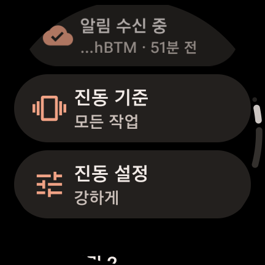
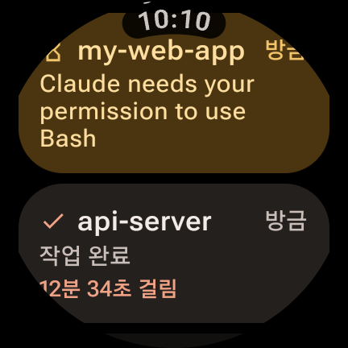
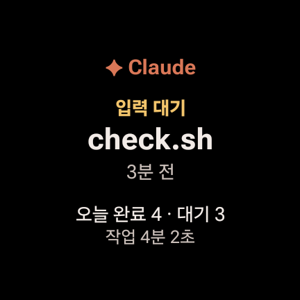
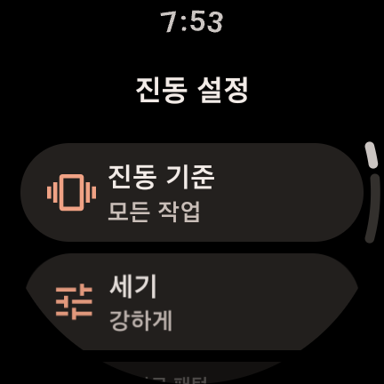
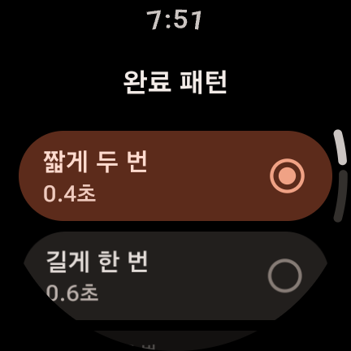
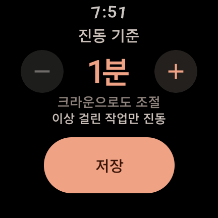
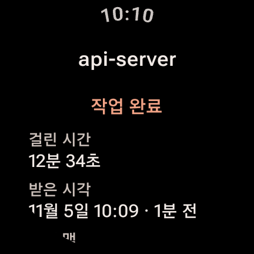
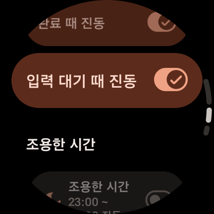

# Claude Watch Notify

맥에서 돌아가는 [Claude Code](https://claude.com/claude-code) 세션이 **작업을 마치거나 입력을 기다리면 갤럭시 워치가 진동**으로 알려 주는 개인용 프로젝트입니다.

긴 작업을 맡겨 두고 자리를 비워도, 손목의 진동으로 "끝났다" 또는 "확인이 필요하다"를 바로 알 수 있습니다. 방해 금지 모드를 항상 켜 두는 환경을 전제로 만들어서, 방해 금지 중에도 진동이 울립니다.

<p align="center">
  
  
  
</p>

## 동작 방식

```
 맥 (Claude Code)                Cloudflare                  Google            갤럭시 워치
┌──────────────────┐  HTTPS   ┌────────────────────┐  HTTPS ┌─────────┐      ┌──────────────────┐
│ 훅 3개            │ ───────▶ │ Worker              │ ─────▶ │ FCM v1  │ ───▶ │ Claude Watch 앱   │
│ watch-notify.sh  │ /notify  │ claude-watch-notify │        └─────────┘      │ 알림 + 진동(ALARM) │
└──────────────────┘          │ KV: TOKENS          │ ◀───────────────────── │ /register        │
                              └────────────────────┘    워치가 토큰 등록       └──────────────────┘
```

1. **맥**: Claude Code 훅(`UserPromptSubmit`, `Stop`, `Notification`)이 이벤트마다 셸 스크립트를 실행합니다. 스크립트는 작업에 걸린 시간을 계산해 Worker로 보내고 바로 끝납니다. 전송은 백그라운드라서 Claude Code는 기다리지 않습니다.
2. **Cloudflare Worker**: 맥의 요청을 비밀값으로 확인한 뒤, 서비스 계정으로 Google OAuth 토큰을 받아 FCM HTTP v1으로 워치에 data 메시지를 보냅니다. 워치 토큰은 KV에 저장합니다.
3. **워치 앱**: 메시지를 받으면 기록을 저장하고 알림을 띄운 뒤, 설정에 따라 직접 진동을 울립니다.

### 왜 이렇게 만들었나
- **진동을 앱이 직접 울립니다.** 갤럭시 워치는 앱 알림 채널의 진동 패턴과 방해 금지 예외 설정을 무시합니다. 그래서 `Vibrator`를 알람 용도로 직접 호출합니다. 덕분에 방해 금지와 취침 모드에서도 울리고, 세기와 패턴도 자유롭게 정할 수 있습니다.
- **중계 서버로 Cloudflare Worker를 씁니다.** FCM으로 보내려면 서비스 계정 키가 필요한데, 이 키를 맥에 두지 않으려고 Worker Secret에만 넣었습니다. 무료 플랜으로 충분하고, 따로 관리할 서버가 없습니다.
- **맥 쪽은 bash, jq, curl만 씁니다.** 설치할 런타임이 없고, 훅이 Claude Code를 느리게 만들지 않습니다.

## 기능

### 알림과 진동
- **작업 완료**와 **입력 대기**(권한 승인, 질문 등)를 서로 다른 진동으로 구분합니다.
- **진동 기준 시간**: 이보다 짧게 끝난 작업은 진동 없이 기록만 남깁니다. 탭하면 0초, 5초, 10초, 30초, 1분 순으로 바뀌고, **길게 누르면** 1~60분을 1분 단위로 고를 수 있습니다(크라운 지원).
- **진동 세기**: 약하게, 보통, 강하게.
- **진동 패턴 7종**: 짧게 두 번, 길게 한 번, 길게 두 번, 톡톡톡, 심장 박동, 점점 세게, 물결. 완료와 입력 대기에 따로 고르고, 고르는 순간 미리 울려 봅니다.
- **이벤트별 켜기/끄기**: 완료 때만, 또는 입력 대기 때만 진동할 수 있습니다.
- **조용한 시간**: 정한 시간대(자정을 넘겨도 됨)에는 진동 없이 기록만 남깁니다. 알람 용도 진동이 밤에 울리지 않게 막는 장치입니다.
- **입력 대기 반복 알림**: 응답하지 않으면 1, 2, 5, 10분 간격으로 최대 3번 다시 울립니다. 같은 세션이 끝나거나 앱을 열면 멈춥니다.

<p align="center">
  
  
  
</p>

### 기록
- 최근 알림을 **최대 10건, 3일** 동안 보관합니다.
- 기록을 누르면 상세 화면에서 걸린 시간, 받은 시각, 보낸 맥을 볼 수 있습니다.
- **프로젝트 음소거**: 특정 프로젝트의 알림은 진동 없이 기록만 남깁니다.
- 기록 전체 삭제는 실수로 지우지 않도록 두 번 탭해야 합니다.

### 워치 타일
- 마지막 알림(프로젝트, 종류, 시각)과 오늘의 완료 건수, 대기 건수, 총 작업 시간을 보여 줍니다.
- 탭하면 앱이 열립니다.

<p align="center">
  
  
</p>

## 프로젝트 구조

```
.
├── wear/      워치 앱 (Kotlin, Jetpack Compose for Wear OS, Room, WorkManager, Tiles)
├── worker/    Cloudflare Worker (TypeScript, WebCrypto로 JWT 서명, KV)
├── hooks/     맥 훅 스크립트와 설치 스크립트 (bash, jq, curl)
├── scripts/   check.sh: 맥, Worker, 워치 상태를 한 번에 점검
└── docs/      설계 문서, 운영 가이드, 스크린샷
```

| 구성 | 기술 |
|---|---|
| 워치 앱 | Kotlin 2.4, AGP 9.3, Wear Compose Material3 1.7, Room, WorkManager, Tiles/ProtoLayout, Firebase Messaging |
| 중계 | Cloudflare Workers, KV, FCM HTTP v1 |
| 맥 | Claude Code hooks, bash, jq, curl |

테스트 기기는 갤럭시 워치7(Wear OS 5)입니다.

## 직접 써 보려면

비밀값과 Firebase 설정은 저장소에 없습니다. 직접 쓰려면 Firebase 프로젝트와 Cloudflare 계정(둘 다 무료)이 필요합니다.

1. Firebase 프로젝트를 만들고 Android 앱을 등록한 뒤, `google-services.json`을 `wear/`에 넣습니다. 패키지 이름을 바꾸려면 `wear/build.gradle.kts`의 `applicationId`도 함께 바꿉니다.
2. Firebase 서비스 계정 키를 받습니다.
3. `worker/`에서 KV를 만들고 배포한 다음, Secret 3개(`FCM_SERVICE_ACCOUNT`, `NOTIFY_SECRET`, `REGISTER_SECRET`)를 등록합니다.
4. 프로젝트 루트의 `local.properties`에 Worker URL과 비밀값을 적습니다.
   ```properties
   claudewatch.workerUrl=https://claude-watch-notify.<서브도메인>.workers.dev
   claudewatch.notifySecret=...
   claudewatch.registerSecret=...
   ```
5. 워치에 앱을 설치하고(`./gradlew :wear:installDebug`), 앱을 열어 알림을 허용합니다.
6. 맥에서 `hooks/install.sh`를 실행하고 `~/.claude/watch-notify/config`에 Worker URL과 `NOTIFY_SECRET`을 적습니다.
7. `scripts/check.sh --send`로 점검합니다. 워치가 진동하면 완료입니다.

자세한 순서와 클릭 경로는 [docs/DESIGN.md](docs/DESIGN.md) 11절과 [docs/OPERATIONS.md](docs/OPERATIONS.md) 4절에 있습니다.

## 문서

- [docs/DESIGN.md](docs/DESIGN.md): 설계 기준, 메시지 스키마, 화면 구성, 결정 기록
- [docs/OPERATIONS.md](docs/OPERATIONS.md): 인프라, 동작 흐름, 재배포, 비밀값 교체, 장애 대응

## 알려진 제약

- 진동이 알람 용도라 취침 모드에서도 울립니다. 앱의 조용한 시간으로 막습니다.
- 반복 알림과 타일 갱신은 Doze 중에 몇 분 늦을 수 있습니다.
- `Stop` 훅은 응답이 끝날 때마다 실행되므로, 여러 턴에 걸친 작업은 알림도 여러 번 옵니다.
- 실패한 전송은 재시도하지 않습니다. 워치가 10분 넘게 오프라인이면 그 사이 알림은 사라집니다.
- 개인용으로 만든 프로젝트라 갤럭시 워치7 외의 기기에서는 확인하지 않았습니다.
